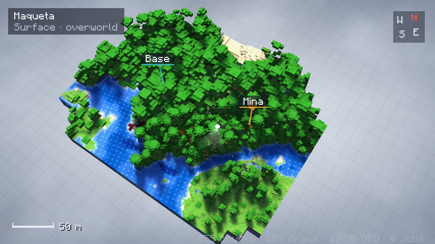
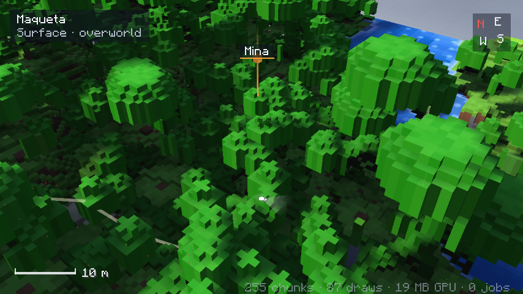
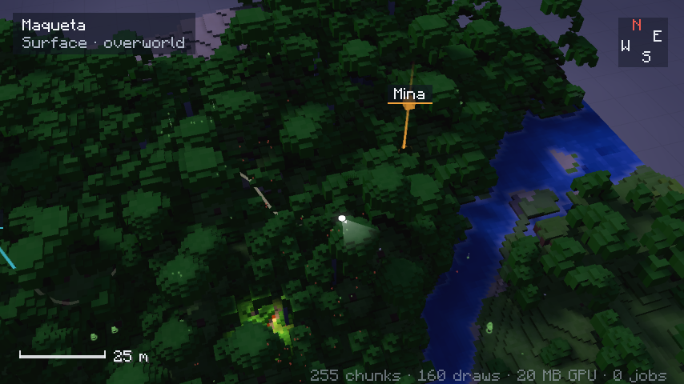
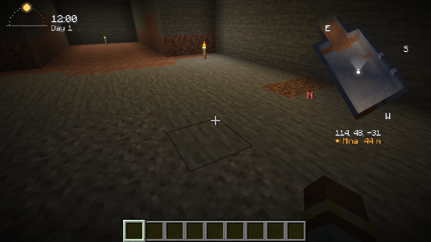
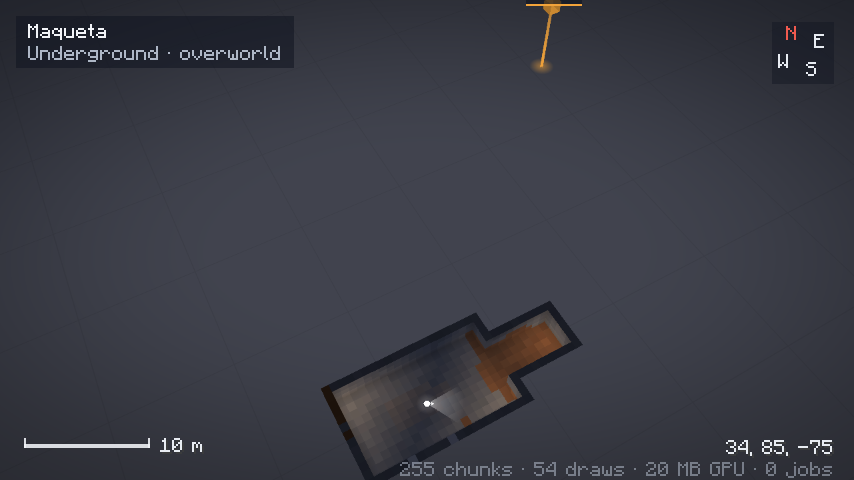

# Maqueta

Mapa y minimapa 3D para **Minecraft 26.3 (Fabric)** que muestra el mundo explorado como una
maqueta estilizada que se puede orbitar, inclinar y recorrer. Todo se dibuja en la GPU con la
API de render nueva del juego (**renderpearl**, el sucesor de Blaze3D), así que funciona igual con
los backends OpenGL y Vulkan, y sin una sola llamada directa a OpenGL (la compilación falla si
alguien importa `org.lwjgl.opengl`).

## Qué hace

| | |
| --- | --- |
| **Minimapa 3D sin bordes** | Vista inclinada centrada en el jugador que se disuelve en niebla irregular hacia los bordes. Ocho posiciones (arriba/centro/abajo × izquierda/centro/derecha), tamaño, margen, alcance e inclinación configurables. Se oculta con inventarios abiertos. |
| **Jugador** | Solo un punto blanco con halo suave, una muesca hacia donde mira y un cono de visión que se desvanece. |
| **Mapa completo** | Cámara tipo Google Earth: arrastrar para mover (con inercia), clic derecho para girar e inclinar, rueda con zoom hacia el cursor, doble clic para volar, Espacio vuelve a ti, N pone el norte arriba. La inclinación se ajusta sola con el zoom. Apertura animada que desciende desde vista cenital. No pausa el juego. |
| **Luz horneada** | Sol fijo desde el noroeste a 35° con sombras suaves (5 rayos), cielo visible (8 direcciones de horizonte), oclusión de contacto por vértice y luz de antorchas con caída. |
| **Día y noche sin rehornear** | Las sombras no se mueven; el shader regradúa los cuatro términos según la hora: día cálido, atardecer naranja/violeta, noche azul con ventanas y antorchas como protagonistas. Lluvia y tormenta bajan saturación y contraste. |
| **Estilo maqueta** | Paleta curada de 120 muestras en OKLab (rampas por material). Bordes de lo explorado cortados como un diorama con estratos (superficie, tierra, piedra). Agua por profundidad con espuma en la orilla y brillo animado. Tablero neutro con cuadrícula de chunks y nubes que derivan sobre lo no explorado. |
| **Cuevas** | Bajo tierra el mapa cambia solo a la capa de subsuelo: plano de corte sobre la cabeza, solo se muestra el espacio conectado al jugador (relleno por inundación), luz de antorchas propagada, exterior oscurecido y desaturado, zoom automático. |
| **Waypoints** | Haz vertical, anillo en el suelo y etiqueta. Crear con B o Mayús+clic en el mapa, editar con Mayús+clic en la etiqueta, seguir uno muestra la distancia bajo el minimapa. Marcador de muerte automático. Guardados en texto legible (`name;x;y;z;RRGGBB;dimension;flags`). |
| **Rastro** | El recorrido se dibuja como una cinta sobre el terreno que se desvanece con la antigüedad. |
| **Figuras** | Mobs y jugadores cercanos que el cliente ya tiene cargados, como fichas de juego de mesa (anillo, tallo, cabeza) a su altura real, con color por tipo. |
| **Sol, luna y hora** | Arco en la esquina superior izquierda con el sol de día y la luna con su fase real de noche, hora 24 h o 12 h, número de día y clima. |
| **Persistencia** | Lo explorado se guarda por mundo y dimensión en regiones de 512 bloques comprimidas, con escritura atómica y versión de formato. Se guardan los datos fuente, no la apariencia: cambiar el estilo no obliga a re-explorar. |
| **Juego limpio** | Solo cliente; usa únicamente lo que el servidor ya envía. Obedece los códigos de chat de Xaero's Minimap (juego limpio, sin minimapa, restablecer) y tiene un modo seguro. |

## Teclas

| Tecla | Acción |
| --- | --- |
| M | Abrir / cerrar el mapa |
| B | Nuevo punto de ruta aquí |
| H | Mostrar / ocultar el minimapa |
| J | Ajustes |
| En el mapa: C | Forzar capa de subsuelo |
| En el mapa: + / − | Zoom |

## Arquitectura

```
core/    Java puro, sin Minecraft (se prueba sin abrir el juego)
         Palette (OKLab), ChunkColumns, TerrainMesher (LOD 0-3), LightBaker,
         CaveMesher, OrbitCamera (reverse-Z), HeightfieldRaycast, RegionStorage,
         Waypoints, Trail, TimeGrading
fabric/  Cliente Fabric 26.3
         world/   captura en dos fases (copia de secciones en el hilo principal,
                  procesado en trabajadores), clasificación de bloques, cuevas, sesión
         render/  pipelines renderpearl, UBO triple buffer, caché de mallas GPU con
                  presupuesto de subida y expulsión LRU, render a textura propia
         hud/     minimapa y arco de sol/luna
         screen/  mapa completo, waypoints, ajustes
```

Pasadas de render: tablero y nubes → terreno opaco (de cerca a lejos, frustum culling,
LOD por distancia) → corte de cueva → marcadores con prueba de profundidad → marcadores
siempre visibles. El mapa se dibuja en una textura propia con color y profundidad (reverse-Z
como el propio juego) y se compone en la interfaz con alfa premultiplicado; el minimapa se
renderiza a 2× y se reduce con filtro lineal.

## Compilar y probar

Requisitos: JDK 25 (ruta configurada en `gradle.properties`).

```bash
./gradlew :core:test
```

```bash
./gradlew :fabric:build
```

```bash
./gradlew :fabric:runClient
```

Capturas reales dentro del juego (crea un mundo, recorre una ruta, abre el mapa de día, al
atardecer, de noche y en una cueva, y el propio juego guarda las capturas):

```bash
./gradlew :fabric:runClientGameTest
```

## Capturas reales

Tomadas por el propio juego (Minecraft 26.3, backend OpenGL) con `runClientGameTest`, sin edición:

| | |
| --- | --- |
|  |  |
|  |  |
|  |  |
