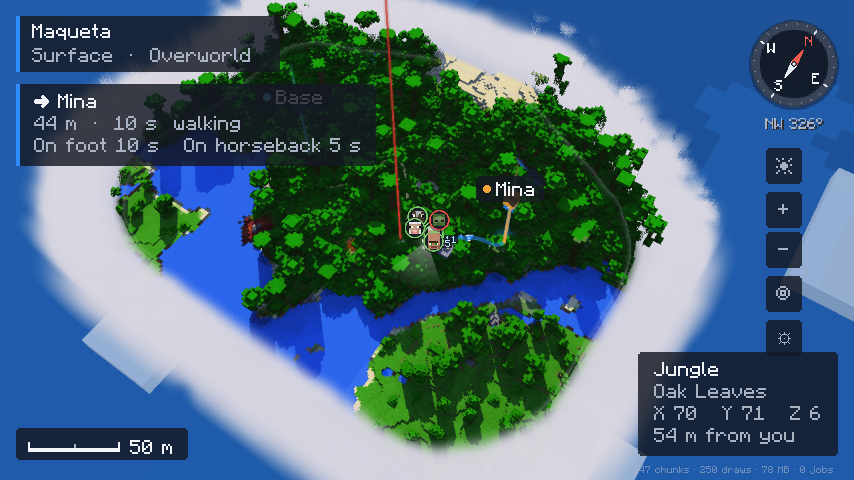
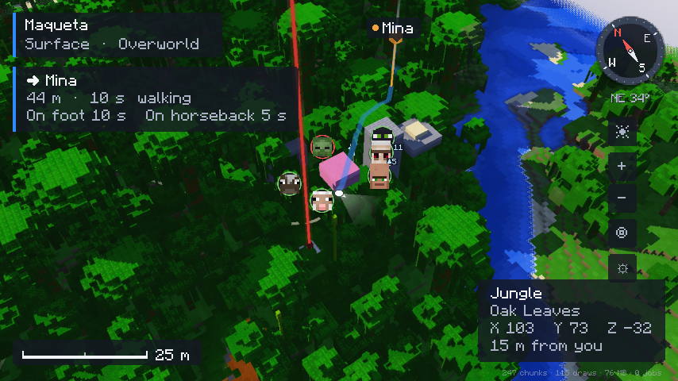
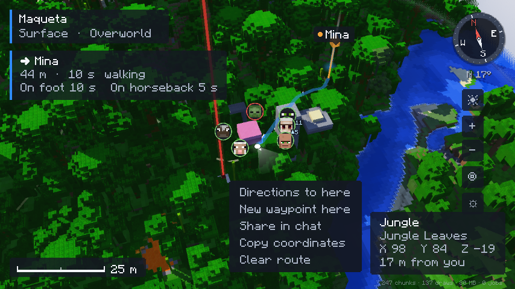
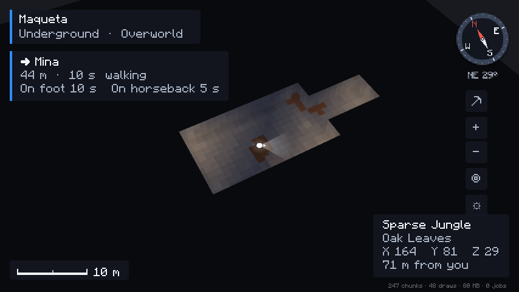
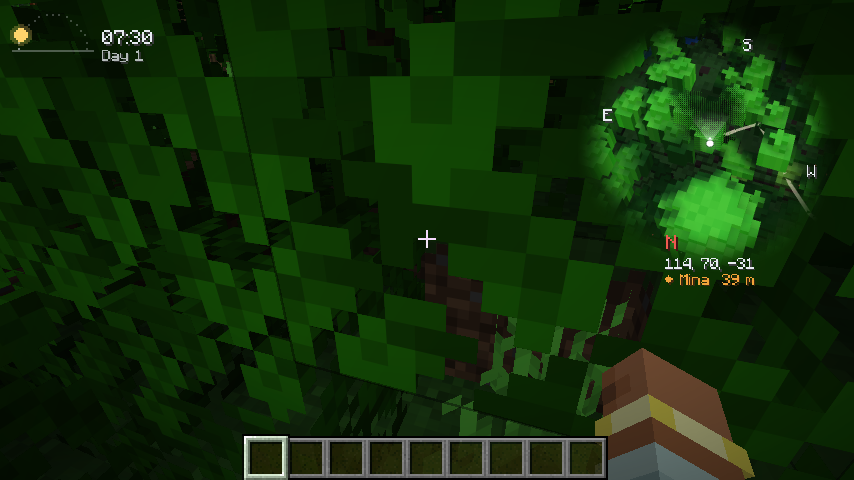
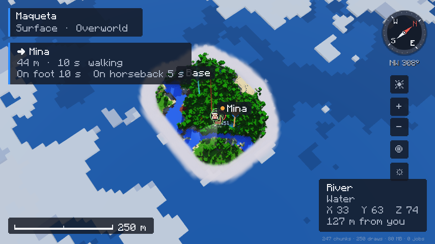

# Maqueta

Mapa y minimapa 3D para **Minecraft 26.3 (Fabric)** que muestra el mundo explorado como una
maqueta estilizada que se puede orbitar, inclinar y recorrer. Todo se dibuja en la GPU con la
API de render nueva del juego (**renderpearl**, el sucesor de Blaze3D), así que funciona igual con
los backends OpenGL y Vulkan, y sin una sola llamada directa a OpenGL (la compilación falla si
alguien importa `org.lwjgl.opengl`).

## Qué hace

| | |
| --- | --- |
| **Minimapa 3D sin bordes** | Vista inclinada centrada en el jugador que se disuelve en niebla irregular hacia los bordes. Ocho posiciones (arriba/centro/abajo × izquierda/centro/derecha), tamaño, margen, alcance e inclinación configurables. Se oculta con inventarios abiertos. |
| **Jugador** | Solo un punto blanco con halo suave, una muesca hacia donde mira y un cono de visión que se desvanece. |
| **Mapa completo** | Cámara tipo Google Earth: arrastrar para mover (con inercia), clic derecho para girar e inclinar, rueda con zoom hacia el cursor, doble clic para volar, Espacio vuelve a ti, N pone el norte arriba. La inclinación se ajusta sola con el zoom. Apertura animada que desciende desde vista cenital. No pausa el juego. |
| **Luz horneada** | Sol fijo desde el noroeste a 35° con sombras suaves (5 rayos), cielo visible (8 direcciones de horizonte), oclusión de contacto por vértice y luz de antorchas con caída. |
| **Día y noche sin rehornear** | Las sombras no se mueven; el shader regradúa los cuatro términos según la hora: día cálido, atardecer naranja/violeta, noche azul con ventanas y antorchas como protagonistas. Lluvia y tormenta bajan saturación y contraste. |
| **Estilo maqueta** | Paleta curada de 120 muestras en OKLab (rampas por material). Bordes de lo explorado cortados como un diorama con estratos (superficie, tierra, piedra). Agua por profundidad con espuma en la orilla y brillo animado. Tablero neutro con cuadrícula de chunks y nubes que derivan sobre lo no explorado. |
| **Cuevas** | Bajo tierra el mapa cambia solo a la capa de subsuelo: plano de corte sobre la cabeza, solo se muestra el espacio conectado al jugador (relleno por inundación), luz de antorchas propagada, exterior oscurecido y desaturado, zoom automático. |
| **Waypoints** | Haz vertical, anillo en el suelo y etiqueta. Crear con B o Mayús+clic en el mapa, editar con Mayús+clic en la etiqueta, seguir uno muestra la distancia bajo el minimapa. Marcador de muerte automático. Guardados en texto legible (`name;x;y;z;RRGGBB;dimension;flags`). |
| **Rastro** | El recorrido se dibuja como una cinta sobre el terreno que se desvanece con la antigüedad. |
| **Figuras** | Mobs y jugadores cercanos que el cliente ya tiene cargados, como fichas de juego de mesa (anillo, tallo, cabeza) a su altura real, con color por tipo. |
| **Sol, luna y hora** | Arco en la esquina superior izquierda con el sol de día y la luna con su fase real de noche, hora 24 h o 12 h, número de día y clima. |
| **Persistencia** | Lo explorado se guarda por mundo y dimensión en regiones de 512 bloques comprimidas, con escritura atómica y versión de formato. Se guardan los datos fuente, no la apariencia: cambiar el estilo no obliga a re-explorar. |
| **Juego limpio** | Solo cliente; usa únicamente lo que el servidor ya envía. Obedece los códigos de chat de Xaero's Minimap (juego limpio, sin minimapa, restablecer) y tiene un modo seguro. |

## Teclas

| Tecla | Acción |
| --- | --- |
| M | Abrir / cerrar el mapa |
| B | Nuevo punto de ruta aquí |
| H | Mostrar / ocultar el minimapa |
| J | Ajustes |
| En el mapa: C | Forzar capa de subsuelo |
| En el mapa: + / − | Zoom |

## Arquitectura

```
core/    Java puro, sin Minecraft (se prueba sin abrir el juego)
         Palette (OKLab), ChunkColumns, TerrainMesher (LOD 0-3), LightBaker,
         CaveMesher, OrbitCamera (reverse-Z), HeightfieldRaycast, RegionStorage,
         Waypoints, Trail, TimeGrading
fabric/  Cliente Fabric 26.3
         world/   captura en dos fases (copia de secciones en el hilo principal,
                  procesado en trabajadores), clasificación de bloques, cuevas, sesión
         render/  pipelines renderpearl, UBO triple buffer, caché de mallas GPU con
                  presupuesto de subida y expulsión LRU, render a textura propia
         hud/     minimapa y arco de sol/luna
         screen/  mapa completo, waypoints, ajustes
```

Pasadas de render: tablero y nubes → terreno opaco (de cerca a lejos, frustum culling,
LOD por distancia) → corte de cueva → marcadores con prueba de profundidad → marcadores
siempre visibles. El mapa se dibuja en una textura propia con color y profundidad (reverse-Z
como el propio juego) y se compone en la interfaz con alfa premultiplicado; el minimapa se
renderiza a 2× y se reduce con filtro lineal.

## Compilar y probar

Requisitos: JDK 25 (ruta configurada en `gradle.properties`).

```bash
./gradlew :core:test
```

```bash
./gradlew :fabric:build
```

```bash
./gradlew :fabric:runClient
```

Capturas reales dentro del juego (crea un mundo, recorre una ruta, abre el mapa de día, al
atardecer, de noche y en una cueva, y el propio juego guarda las capturas):

```bash
./gradlew :fabric:runClientGameTest
```

## Estilo visual (v0.3)

Una reinterpretación propia, no una copia de otros mapas:

- **Teselas de material 4×4**: cada cara de bloque se reinterpreta desde la textura del modelo del juego, reducida a 4×4, suavizada, con un bisel de un texel (pieza tallada de maqueta) y guardada como *contraste relativo* al color de la paleta. La paleta manda en el color; la tesela solo aporta el carácter del material (veta, minerales, corteza, huecos de las hojas). Se desvanece con la distancia para no parpadear.
- **Sombras por píxel**: un mapa de alturas en la GPU (1024×1024, envolvente) permite trazar el rayo del sol fijo por cada texel: sombras nítidas que siguen la cuadrícula 4×4, también sobre la mesa.
- **Luz pixelada**: la luz horneada (oclusión, cielo, antorchas) se reevalúa en el centro de cada texel, con un leve bandeado pictórico. Luz cálida y sombras frías.
- **Agua pixel-art**: profundidad por escalones, ondas en guiones que derivan, destellos sueltos y espuma con tramado ordenado en la orilla.
- **Árboles**: copas como volúmenes limpios sobre troncos esbeltos con su corteza real; el suelo bajo el bosque se ve y se puede recorrer.
- **La mesa**: la maqueta descansa sobre una mesa de cartógrafo (papel con grano, cuadrícula de chunks punteada, regiones), proyecta su sombra sobre ella, presiona su base, y pequeñas nubes pixeladas abrazan el borde de lo explorado. A lo lejos, un horizonte de estudio en lugar del vacío.
- **Cuevas**: el espacio conectado se ilumina; las demás cuevas se dibujan atenuadas y frías, y el plano de corte es una sección geológica con rayado (en modo juego limpio solo se ve el espacio conectado).

## Funciones nuevas

| | |
| --- | --- |
| **Rutas tipo navegador** | Clic derecho → «Cómo llegar aquí» o clic en un punto: A* sobre lo explorado (sube como mucho 1 bloque, caídas seguras, nadar cuesta más, prefiere caminos), suavizado y dibujado sobre el terreno con flechas en movimiento. Tiempo estimado según cómo viajas (andando, corriendo, nadando, a caballo con su velocidad real, en barca); se recalcula si te sales y avisa al llegar. |
| **Menú contextual** | Clic derecho sin arrastrar: ruta, nuevo punto, compartir en el chat, copiar coordenadas, quitar ruta. |
| **Compartir compatible** | Envía en formato de Xaero's; reconoce en el chat puntos de Xaero's, JourneyMap y Maqueta y los añade al mapa. |
| **Información del cursor** | Bioma, bloque, coordenadas, altura y distancia del punto bajo el ratón. |
| **Brújula profesional** | Bisel con 24 marcas que gira con la cámara, aguja bicolor al norte, rumbo en grados; clic para norte arriba. Botones de capa, zoom y «a mí». |
| **Criaturas por altura** | Cada criatura es un icono (su huevo de generación o la cara del jugador) colocado en su altura 3D real, con anillo en el suelo, hilo de altura y marca ▲/▼ relativa a ti: en una torre, el piso 1 y el piso 10 no se pisan. |
| **Sin reloj** | Se quitó el indicador de hora del HUD. |

## Capturas reales

Tomadas por el propio juego (Minecraft 26.3, backend OpenGL) con `runClientGameTest`, sin edición:

| | |
| --- | --- |
|  |  |
|  |  |
|  |  |

## v0.4: el mapa fiel al mundo

Detalle en [docs/PLAN-v0.4.md](docs/PLAN-v0.4.md). En resumen:

- **Columnas por capas**: se guardan los tramos de bloques reales con el aire entre ellos. Ramas, voladizos, puentes y bloques flotantes quedan donde están; ya no se rellena hasta el suelo ni se inventan troncos.
- **Formas reales** para escaleras, losas, alfombras, antorchas, faroles, lianas, bambú, vallas… (hasta 6 cajas por estado de bloque). Flores y hierba siguen como motas de color.
- **Color fiel**: tinte del bioma × brillo de la textura (como el juego), sin arrastrar el tono a una rampa: cerezos rosas, abetos y abedules con su color, la nieve solo pinta la cara de arriba.
- **Bordes en relieve**: sin paredes hacia lo inexplorado; el terreno desciende suavemente hasta la mesa.
- **Bruma atmosférica** según la distancia (como Google Earth) y **nubes** con su sombra, que aparecen al alejar la cámara y dejan despejado el punto que miras.
- **Transparencia solo entre la cámara y el jugador**, en mapa y minimapa.
- **Criaturas por capa** (superficie, cueva o tu altitud, con las demás atenuadas), leídas una vez por tick, con **su cara real** como icono.
- **Tab** cambia el alcance del minimapa; **panel de ajustes rápidos** (⚙) dentro del mapa; **rastro** configurable (500 bloques por defecto).
- Probado en **OpenGL y Vulkan** (`./gradlew :fabric:runClientGameTest -PmaquetaVulkan`).



## v0.5

Detalle en [docs/PLAN-v0.5.md](docs/PLAN-v0.5.md): nada flotante se rellena (suelo = material natural con sólido debajo), fosos y estructuras profundas visibles, dimensiones aisladas, iconos de criaturas rápidos (insignias horneadas, caras para las 32 más cercanas), sombras estables a cualquier zoom, el mapa entero visible a cualquier distancia, fondo de **océano pixel**, **bancos de nubes 3D** en el borde vestidos según el bioma (blancas, tormenta con relámpagos, nieve, arena), texturas naturales sin cuadrícula, troncos con su corteza, cerezos rosas, haces de **faros** activos con su color, y el atajo del minimapa sin tecla por defecto (chocaba con la H de MiniHUD).

## v0.6

Detalle en [docs/PLAN-v0.6.md](docs/PLAN-v0.6.md). Lo principal:

- **Relleno resuelto de raíz.** El detalle cercano ya no son columnas: es una rejilla de vóxeles con la misma regla de caras ocultas que usa Minecraft. Lo flotante, los arcos, los voladizos, el interior de las torres y los manglares se ven tal cual.
- **Bordes rectos** con un **banco de niebla** que siempre los cubre. Fuera, mar con **pocas nubes**.
- **Importa lo que JourneyMap ya trazó** (`journeymap/data/.../day/*.png`). Se ve como bocetos planos a nivel del mar hasta que Maqueta visita la zona; no se guardan como propios. Se activa o desactiva en el panel ⚙.
- **Luces suaves** por vértice, sin escalones por bloque.
- **Mallas precocinadas** en segundo plano mientras juegas: el mapa abre ya listo.
- Al abrir, el mapa se **centra en el jugador** y el **mundo se pausa** (un jugador).
- **Círculo de transparencia** ×2 en el mapa y ×2,5 en el minimapa.
- **Todas las criaturas** con icono; las lejanas se actualizan menos.
- **Cerezos rosas**, colores de bioma fieles, y la cámara baja ya no deja de dibujar.


## Rendimiento y problemas conocidos

El mod todavía pesa más de lo que debería: tirones al cargar chunks, minimapa redibujado completo cada frame y portales lentos. La auditoría, los problemas conocidos y el orden de optimización (sin perder calidad visual) están en [docs/RENDIMIENTO.md](docs/RENDIMIENTO.md).
